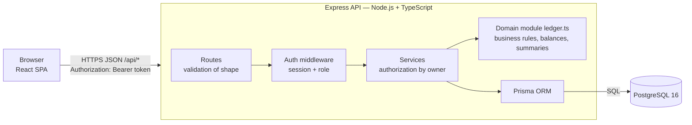
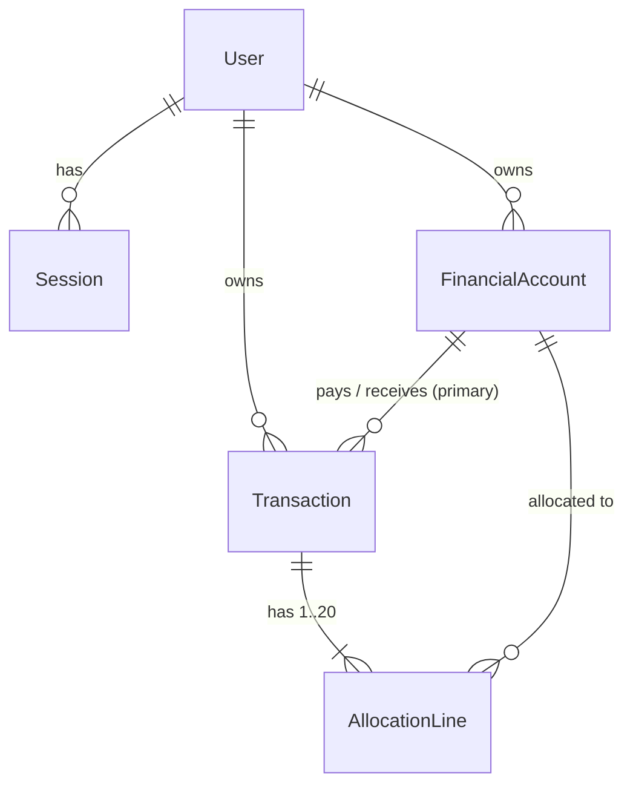

# System-Level Software Design Specification — MoneyLog

Version 1.1 (14 Nov 2026). v1.1: the seed also creates *Loan from Mom* (LOAN_TAKEN/OTHER_LOAN), which AC-06-3 (borrowing) needs. 11 starter accounts per user. Requirement IDs refer to [`srs.md`](srs.md), and feature IDs refer to [`features.md`](features.md).

## 1. Architecture and stack

MoneyLog is a **modular monolith** with three logical layers. Locally it runs as two processes: Vite for the UI, and Express for the API. In production it is **one container** in which Express serves both the API and the built UI.



| Layer | Technology | Responsibility |
|---|---|---|
| UI | React 18 + TypeScript + Vite | Screens, forms, client-side checks for fast feedback (never trusted), shows server errors |
| API / application | Node.js + Express 4 + TypeScript | Routing, input parsing, authentication (session lookup), role checks, owner checks, transactions |
| Domain | `server/src/domain/ledger.ts` (pure functions) | Money parsing, BR-06…BR-14 validation, double-entry effects, balances, summaries. No I/O, fully unit-tested |
| Persistence | Prisma 5 + PostgreSQL 16 | Schema, migrations, constraints, atomic writes (`prisma.$transaction`) |

**Why this stack.** It is the stack the team used in Labs 1–4 (TokTickIT), so tests, tooling and the Lab 5 delivery kit (Docker, Cloud Run, Cloud SQL) apply directly. PostgreSQL gives transactions and constraints for money data.

**Where business rules are enforced.** Every rule is enforced in the API: in the domain module and in the services that call it. The UI repeats a few checks (lines must equal the total, required fields) only to give feedback; the server rejects the same input independently (see TEST-API-31).

## 2. Data model



| Entity | Fields (type) | Constraints and notes |
|---|---|---|
| **User** | id (uuid), email (text), fullName, passwordHash, role (`USER`/`ADMIN`), isActive (bool), createdAt, updatedAt | email unique; bcrypt hash only (NFR-01) |
| **Session** | id, tokenHash (text), userId → User, expiresAt, revokedAt?, createdAt | tokenHash unique; index on userId; cascade delete with user (NFR-03) |
| **FinancialAccount** | id, ownerId → User, name, type (`CASH`,`LOAN_GIVEN`,`LOAN_TAKEN`,`INCOME`,`EXPENSE`), subtype? (`WALLET`,`BANK`,`CREDIT_CARD`,`OTHER_LOAN`), openingBalance (int satang, default 0), openingDate (date?), isActive, createdAt | unique (ownerId, name) (BR-05); opening balance only for CASH/LOAN_* (BR-13, checked in domain) |
| **Transaction** | id, ownerId → User, kind (`PAYMENT`,`RECEIPT`), date (date), description (≤ 200), totalAmount (int satang > 0), primaryAccountId → FinancialAccount, isFavorite (bool, Sprint 3), createdAt | DB CHECK totalAmount > 0; index (ownerId, date desc) |
| **AllocationLine** | id, transactionId → Transaction, accountId → FinancialAccount, amount (int satang > 0), position (int) | DB CHECK amount > 0; cascade delete with transaction |

**Ownership.** Every financial row is owned by exactly one user, either directly (`ownerId`) or through its transaction. Services always filter by `ownerId = currentUser.id` (BR-01).

**Balances are derived, never stored** (decision D-01). An account's balance is its opening balance, plus or minus the sums of the allocation lines and primary amounts that touch it, according to the BR-11 table. This makes corrections in Sprint 2 safe: change the lines and every balance follows.

**Setup, migrations, seed.** `npx prisma migrate deploy` applies versioned SQL migrations from `server/prisma/migrations/`. `npm run prisma:seed` is idempotent (upserts). It creates one administrator and three users (Alice, Bob, and Dan, who is disabled). Each enabled user gets these accounts: *Bangkok Bank Savings* (CASH/BANK), *Wallet* (CASH/WALLET), *KTC Credit Card* (LOAN_TAKEN/CREDIT_CARD), *Loan from Mom* (LOAN_TAKEN/OTHER_LOAN), *Loan to Ploy* (LOAN_GIVEN), income accounts *Salary* and *Interest Earned*, and expense accounts *Dining*, *Groceries*, *Electricity* and *Telecom*. No transactions are seeded, so the Sprint 1 journey starts from zero. Seed passwords come from `SEED_ADMIN_PASSWORD` / `SEED_USER_PASSWORD`. A local fallback is used only when `NODE_ENV` is not `production`.

## 3. UI structure and conventions

| Screen (route) | Role | Purpose |
|---|---|---|
| Sign in (`/login`) | anyone | e-mail + password; generic error on failure |
| Dashboard (`/`) | USER | totals (cash, credit card debt, loans taken, loans given), account balances, this month's income/expense |
| Accounts (`/accounts`) | USER | accounts grouped by type with balance; set opening balance |
| New transaction (`/transactions/new`) | USER | tabs *Make a payment* / *Receive money*; account, date, description, total; dynamic allocation lines; live "remaining to allocate" |
| History (`/transactions`) | USER | table newest first; expand row to see lines |
| Summary (`/summary`) | USER | date range; income, expense, net, per-account totals |
| Users (`/admin/users`) | ADMIN | list users; enable/disable |

Shared behaviour:
- **Navigation by role.** A user sees Dashboard, Accounts, New, History and Summary. An administrator sees only Users. Hiding links is cosmetic; the API enforces access.
- **Validation.** Labelled fields. Errors appear under the field (`role="alert"`). The form keeps its values after a server error.
- **Loading** shows a "Loading…" text and disables submit buttons (no double submit). **Empty** states explain what to do ("No transactions yet — record your first one"). **Errors** show the server message and a Retry button for failed loads.
- Money is displayed as `฿1,234.50`. Negative cash is shown in red (BR-15).
- Layout works from 360 px wide (NFR-09).

## 4. API approach

- REST-style JSON under `/api`. Authenticated requests send `Authorization: Bearer <token>`.
- **Money** is exchanged as decimal strings with at most 2 decimals (`"1250.50"`) and converted to integer satang at the boundary (NFR-04).
- **Dates** are `YYYY-MM-DD` strings.
- **Success**: `200` with a JSON body, `201` on creation, `204` on logout.
- **Errors** always use one shape, without stack traces or SQL:
  ```json
  { "error": { "code": "LINES_TOTAL_MISMATCH", "message": "Allocation lines (1,000.00) must equal the total (1,200.00).", "details": [ { "field": "lines", "message": "..." } ] } }
  ```
  `400 VALIDATION_ERROR` / rule codes · `401 UNAUTHENTICATED` · `403 FORBIDDEN` · `404 NOT_FOUND` · `409 CONFLICT` · `500 INTERNAL_ERROR` (generic message, details only in server logs).
- Feature contracts in `docs/sprints/sprint-1/` define each endpoint's request and response.

| Method + path | Role | Feature |
|---|---|---|
| `POST /api/auth/login` | public | F-01 |
| `POST /api/auth/logout` | any signed-in | F-01 |
| `GET /api/auth/me` | any signed-in | F-01 |
| `GET /api/admin/users` | ADMIN | F-02 |
| `PATCH /api/admin/users/:id` | ADMIN | F-02 |
| `GET /api/accounts` | USER | F-03 |
| `PUT /api/accounts/:id/opening-balance` | USER | F-04 |
| `POST /api/transactions` | USER | F-05, F-06 |
| `GET /api/transactions` | USER | F-08 |
| `GET /api/transactions/:id` | USER | F-08 |
| `GET /api/summary?from=&to=` | USER | F-07 |
| `GET /api/health`, `GET /api/ready` | public | R-01 |

## 5. Roles and permissions

| Operation | Anonymous | USER | ADMIN |
|---|---|---|---|
| Sign in | ✔ | ✔ | ✔ |
| Sign out, read own identity | ✗ 401 | ✔ | ✔ |
| List users, enable/disable a user | ✗ 401 | ✗ 403 | ✔ (not self, not the last admin — BR-04) |
| Read accounts and balances | ✗ 401 | ✔ own only | ✗ 403 (BR-02) |
| Set opening balance | ✗ 401 | ✔ own accounts only | ✗ 403 |
| Record payment / receipt | ✗ 401 | ✔ own accounts only (BR-10) | ✗ 403 |
| Read history / transaction detail | ✗ 401 | ✔ own only; other user's → 404 | ✗ 403 |
| Read summary | ✗ 401 | ✔ own only | ✗ 403 |
| Later: manage accounts, correct, favorites, duplicate, reports | ✗ 401 | ✔ own only | ✗ 403 |

Implementation: `requireAuth` loads the session and user on every request. `requireRole('USER')` or `requireRole('ADMIN')` guards each router. Every financial query includes `ownerId: req.user.id`, so another user's record is simply *not found* (decision D-06).

## 6. Authentication and session lifecycle

1. **Login.** The server looks up the user by e-mail and compares the password with `bcrypt.compare`. If the user does not exist, the password is wrong, or the user is disabled, the answer is the same `401 INVALID_CREDENTIALS`.
2. **Session creation.** The server generates a token with `crypto.randomBytes(32)` (256 bits). It stores only `sha256(token)` with `expiresAt = now + 8 h` and returns the raw token once.
3. **Each request.** The middleware hashes the bearer token, finds a session that is not revoked and not expired, and checks that its user is still enabled (BR-03). Otherwise it answers `401`.
4. **Current user.** `GET /api/auth/me` returns `{ id, email, fullName, role }`, never the hash.
5. **Logout.** The server sets `revokedAt` and answers `204`. The client drops its token, and any later use of the token gets `401`.
6. **Disable.** When an administrator disables a user, all of that user's sessions are revoked.

The client keeps the token in `sessionStorage`, so it is cleared when the tab closes, and sends it in the header. No cookies are used, so CSRF does not apply.

## 7. Configuration, secrets and deployment plan

| Variable | Purpose | Secret |
|---|---|---|
| `DATABASE_URL` | PostgreSQL connection string | yes |
| `PORT` | HTTP port (local 4000, container 3000) | no |
| `NODE_ENV` | `production` in the cloud | no |
| `SESSION_TTL_HOURS` | session lifetime, default 8 | no |
| `SEED_ADMIN_PASSWORD`, `SEED_USER_PASSWORD` | seed passwords; required in production | yes |
| `CORS_ORIGIN` | optional allowed origins (local dev only) | no |

- Only `.env.example` files with placeholders are committed. Real values live in local `.env` files, which are git-ignored, and in the cloud in Secret Manager. The client has no secrets.
- **Docker (Lab 5).** A multi-stage image builds the client and server and runs `node dist/index.js` as a non-root user on `$PORT`. Express serves `client/dist`. No file is written to the container disk; everything is in PostgreSQL (NFR-06).
- **GCP plan (Lab 5).** Artifact Registry for images; **Cloud Run** service (min 0, max 3 instances); Cloud Run **job** for `prisma migrate deploy` + seed before each release; **Cloud SQL for PostgreSQL 16** (smallest tier); **Secret Manager** for `DATABASE_URL` and seed passwords; GitHub Actions with Workload Identity Federation to build, test and deploy from `main`; images tagged with the commit SHA.
- **CI.** From Sprint 1, a GitHub Actions workflow runs backend tests against a PostgreSQL service, then frontend tests and build, on every Pull Request into `staging` and `main` (NFR-08).
